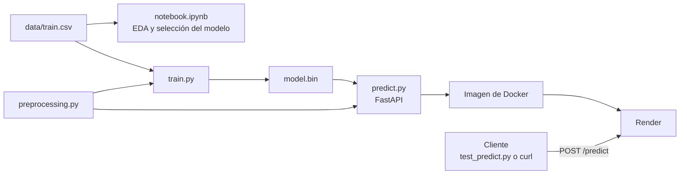
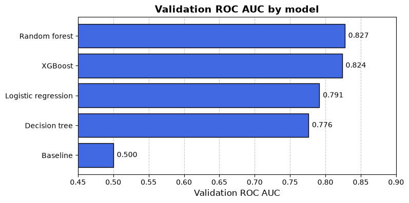
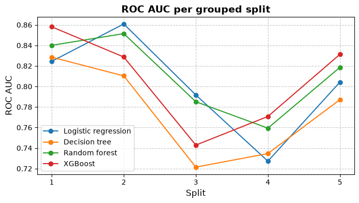
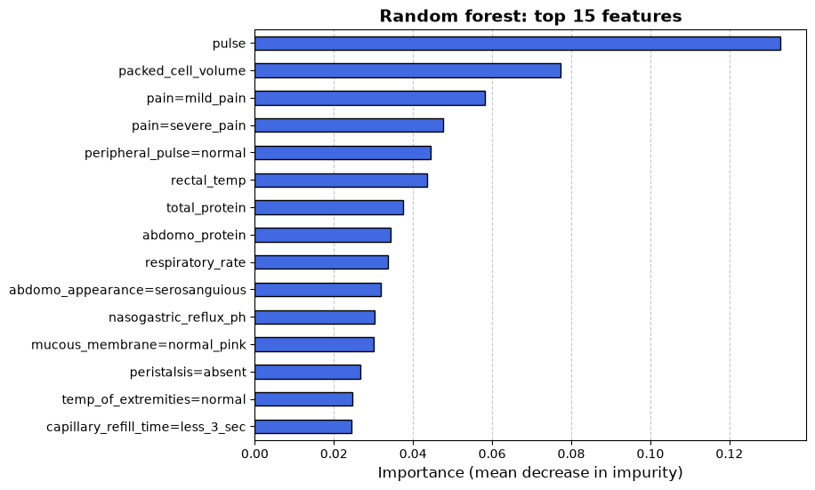
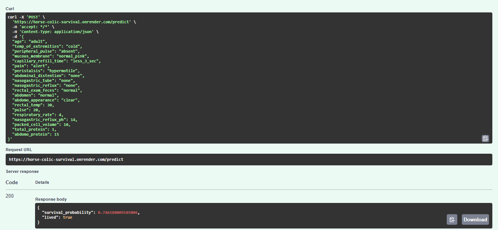
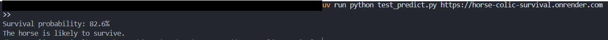

# Predicción de supervivencia en caballos con cólico

[English](README.md) | **Español**

Un servicio web de machine learning que estima la probabilidad de que un caballo con cólico sobreviva, a partir de la información disponible cuando ingresa en un hospital veterinario.

Proyecto intermedio (*midterm*) de [ML Zoomcamp](https://github.com/DataTalksClub/machine-learning-zoomcamp).

## Problema

El cólico (dolor abdominal) es una afección grave y potencialmente mortal en los caballos. En el ingreso, los veterinarios tienen que valorar rápidamente la gravedad del caso y hablar de las opciones con el propietario.

Este proyecto entrena un modelo con datos clínicos como las constantes vitales, el nivel de dolor y los hallazgos de la exploración. El modelo se ofrece a través de una API: un cliente envía los datos de un caballo y recibe una probabilidad de supervivencia.

La puntuación está pensada para apoyar el criterio del veterinario, no para sustituirlo.

## Datos

El proyecto usa los datos de entrenamiento de la competición de Kaggle [Predict Health Outcomes of Horses](https://www.kaggle.com/competitions/playground-series-s3e22) (Playground Series S3E22). Es un conjunto de datos sintético, generado a partir del [Horse Colic dataset](https://archive.ics.uci.edu/dataset/47/horse+colic) real de UCI, que tiene 368 casos.

- **Tamaño:** 1.235 filas etiquetadas y 29 columnas.
- **Objetivo original:** `outcome`, con los valores `lived`, `died` y `euthanized`.
- **Objetivo del proyecto:** `lived` frente a `not lived` (`died` + `euthanized`).
- **Por qué binario:** el servicio estima la supervivencia, y la eutanasia es en parte una decisión humana, no un resultado puramente clínico.
- **Valores nulos:** 464 filas tienen algún nulo, todos en columnas categóricas. El CSV los guarda como el texto `None`, que pandas lee como nulo por defecto. Es distinto de `none` en minúscula, una categoría válida en columnas como `abdominal_distention`.
- **Casos repetidos:** `hospital_number` tiene 255 valores distintos en las 1.235 filas, y 198 de ellos aparecen más de una vez. Como los datos son sintéticos, un valor repetido no implica necesariamente el mismo caballo: 161 de esos 198 valores tienen más de un resultado.

El `test.csv` de la competición no tiene la columna `outcome` (sus etiquetas están ocultas), así que no se usa: los conjuntos de validación y test salen de `train.csv`.

### Columnas excluidas

| Columnas | Motivo |
|---|---|
| `id`, `hospital_number` | Identificadores (`hospital_number` no es una variable del modelo, pero se usa para agrupar filas al separar los datos) |
| `cp_data` | UCI la describe como sin significado |
| `surgical_lesion`, `lesion_1`, `lesion_2`, `lesion_3` | Solo se conocen después de la cirugía o la autopsia, así que filtrarían información del futuro |
| `surgery` | Es una decisión de tratamiento que normalmente no se toma en el ingreso; quitarla no cambia el AUC de validación (0,752 sin ella, 0,751 con ella) |

El modelo usa las 20 variables restantes: 7 numéricas y 13 categóricas.

## Enfoque

1. **Preparación de los datos:** rellenar los nulos categóricos con una categoría `"unknown"`, unir cinco categorías raras (artefactos de los datos sintéticos) con categorías existentes y convertir a g/dL los valores de `total_protein` registrados en g/L.
2. **Análisis exploratorio:** rangos de valores, nulos, distribución del objetivo, tasa de supervivencia y riesgo relativo por categoría, información mutua, AUC de cada variable por separado y correlaciones.
3. **Estrategia de validación:** los datos se separan en entrenamiento (60 %), validación (20 %) y test (20 %) con `StratifiedGroupKFold`, de modo que cada valor de `hospital_number` aparece en un solo conjunto. Una separación al azar da un AUC más optimista (0,773 frente a 0,751 con el mismo modelo), porque las filas que comparten valor suelen ser casi copias.
4. **Entrenamiento de modelos:** regresión logística, árbol de decisión, random forest y XGBoost, con sus hiperparámetros ajustados en el conjunto de validación.
5. **Selección del modelo:** por ROC AUC, con accuracy y F1 como métricas de apoyo. Como un único conjunto de validación de 248 filas tiene mucho ruido, la clasificación se comprueba también en cinco separaciones por grupos de los datos de entrenamiento y validación. El modelo elegido se reentrena con entrenamiento y validación juntos y se evalúa una sola vez en test.
6. **Despliegue:** el modelo final se sirve con FastAPI, se empaqueta con Docker y se despliega en la nube.

Todo el análisis está en [`notebook.ipynb`](notebook.ipynb) (en inglés).



## Resultados

### Lo más destacado del EDA

- Las clases están casi equilibradas: el 46,5 % de los caballos sobrevivió y el 53,5 % no.
- `pain` es la variable más informativa: sobrevive el 94 % de los caballos alerta, frente al 13–15 % de los que tienen dolor intenso o extremo.
- Entre las numéricas, un `pulse` alto y un `packed_cell_volume` alto (señal de deshidratación) son los indicios más claros de mal pronóstico (AUC de 0,68 cada una por separado).
- Los signos de mala circulación (mucosas cianóticas, extremidades frías, pulso periférico ausente) y el líquido abdominal serosanguinolento van asociados a menor supervivencia.
- Los nulos son informativos: los caballos sin sonda nasogástrica o sin exploración abdominal registradas sobreviven menos que la media.

### Comparación de modelos

| Modelo | Hiperparámetros elegidos | AUC de validación | AUC medio en 5 separaciones por grupos |
|---|---|---|---|
| **Random forest** | `n_estimators=200, max_depth=10, min_samples_leaf=5` | **0,827** | **0,811 ± 0,038** |
| XGBoost | `learning_rate=0.05, max_depth=3, min_child_weight=10, n_estimators=200` | 0,824 | 0,806 ± 0,048 |
| Regresión logística | `C=0.001` | 0,791 | 0,802 ± 0,049 |
| Árbol de decisión | `max_depth=3, min_samples_leaf=20` | 0,776 | 0,776 ± 0,047 |
| Referencia (clase más frecuente) | – | 0,500 | – |



Se elige el random forest porque tiene el mejor ROC AUC en las dos estimaciones. XGBoost está prácticamente empatado con él: como muestran las cinco separaciones por grupos, cada uno gana en algunas, y las diferencias entre separaciones son mayores que las diferencias entre modelos.



### Modelo final en el conjunto de test

Reentrenado con entrenamiento y validación (988 filas) y evaluado una sola vez en test (247 filas):

| ROC AUC | Accuracy | F1 |
|---|---|---|
| 0,761 | 0,725 | 0,657 |

La puntuación en test está en el extremo bajo del rango observado entre separaciones de validación (0,759–0,851), en parte porque un solo grupo de `hospital_number` supone el 19 % de las filas de test. Con el umbral de 0,5 el modelo es prudente: reconoce el 86 % de los caballos que no sobrevivieron, pero solo el 57 % de los que sí, así que la probabilidad es más informativa que la etiqueta sí/no.

Las variables más importantes del modelo final coinciden con el EDA: lideran `pulse` y `packed_cell_volume`, seguidas del nivel de dolor y de los signos de circulación.



## Requisitos

- [Git](https://git-scm.com/)
- [uv](https://docs.astral.sh/uv/), que gestiona Python y las dependencias del proyecto
- [Docker](https://www.docker.com/), para ejecutar el servicio en un contenedor
- Una cuenta de [Kaggle](https://www.kaggle.com/), para descargar los datos (el token de la API solo hace falta para la descarga por línea de comandos)

## Cómo ejecutarlo

### 1. Instalar las dependencias

```bash
git clone git@github.com:IgnaciocefisDataTalksClubCamps/horse-colic-survival.git
cd horse-colic-survival
uv sync --locked
```

`uv sync` crea el entorno virtual en `.venv` con todas las dependencias, incluidas las de desarrollo que usa el notebook (Jupyter, la CLI de Kaggle, librerías de gráficos y XGBoost). Puedes anteponer `uv run` a los comandos, como se muestra abajo, para no tener que activarlo. Para activarlo manualmente:

```bash
source .venv/bin/activate      # Linux/macOS
.venv\Scripts\activate         # Windows
```

### 2. Descargar los datos

Los datos no están incluidos en este repositorio porque las reglas de la competición (sección 7.B) no permiten redistribuirlos.

Acepta las [reglas de la competición](https://www.kaggle.com/competitions/playground-series-s3e22/rules), configura tu token de la API de Kaggle y ejecuta:

```bash
uv run kaggle competitions download -c playground-series-s3e22 -p data --unzip
```

También puedes descargar los archivos desde la [página de datos](https://www.kaggle.com/competitions/playground-series-s3e22/data) de la competición, sin token, y descomprimirlos en `data/`. El archivo de entrenamiento tiene que quedar en `data/train.csv`, no en una subcarpeta.

### 3. Explorar el notebook (opcional)

```bash
uv run jupyter notebook notebook.ipynb
```

### 4. Entrenar el modelo

```bash
uv run python train.py
```

Entrena el random forest con entrenamiento y validación, muestra sus métricas en test y guarda el modelo en `model.bin`:

```text
Training on 988 rows, testing on 247 rows
Test ROC AUC:  0.761
Test accuracy: 0.725
Test F1:       0.657
Model saved to model.bin
```

`model.bin` ya está incluido en el repositorio, así que este paso solo hace falta para reproducirlo.

### 5. Ejecutar el servicio en local

```bash
uv run uvicorn predict:app --host 0.0.0.0 --port 9696
```

### 6. Ejecutar el servicio con Docker

```bash
docker build -t horse-colic-survival .
docker run -it --rm -p 9696:9696 horse-colic-survival
```

La imagen instala solo las dependencias de ejecución (`uv sync --locked --no-dev`) y copia `predict.py`, `preprocessing.py` y `model.bin`.

## Uso de la API

Con el servicio en marcha, puedes usar cualquiera de estas opciones:

- Abrir la documentación interactiva en <http://localhost:9696/docs>.
- Enviar una petición de ejemplo con el script de prueba. Acepta la URL del servicio como argumento opcional:

  ```bash
  uv run python test_predict.py                              # http://localhost:9696
  uv run python test_predict.py https://<url-del-servicio>   # servicio desplegado
  ```

- Enviar una petición con `curl` (en PowerShell de Windows, usa `curl.exe`):

  ```bash
  curl -X POST http://localhost:9696/predict \
    -H "Content-Type: application/json" \
    -d '{"age": "adult", "temp_of_extremities": "normal", "peripheral_pulse": "normal",
         "mucous_membrane": "bright_pink", "capillary_refill_time": "less_3_sec", "pain": "alert",
         "peristalsis": "normal", "abdominal_distention": "none", "nasogastric_tube": "none",
         "nasogastric_reflux": "none", "rectal_exam_feces": "normal", "abdomen": "normal",
         "abdomo_appearance": "clear", "rectal_temp": 38.5, "pulse": 60, "respiratory_rate": 20,
         "nasogastric_reflux_ph": 7.0, "packed_cell_volume": 35.0, "total_protein": 7.0,
         "abdomo_protein": 2.0}'
  ```

  Respuesta (para este caballo, la probabilidad es de aproximadamente 0,83):

  ```json
  {"survival_probability": 0.826, "lived": true}
  ```

| Endpoint | Método | Para qué sirve |
|---|---|---|
| `/predict` | POST | Recibe los datos clínicos de un caballo y devuelve la probabilidad de supervivencia |
| `/health` | GET | Comprueba que el servicio funciona |
| `/docs` | GET | Documentación interactiva (la URL raíz `/` redirige aquí) |

### Campos de entrada

Los campos numéricos son obligatorios. Los categóricos son opcionales: un valor ausente se trata como `"unknown"`, igual que en el entrenamiento. Los campos desconocidos, las categorías no válidas y los valores fuera de rango se rechazan con un error `422`.

| Campo | Valores aceptados |
|---|---|
| `rectal_temp` | 30 – 45 (°C) |
| `pulse` | 20 – 250 (latidos por minuto) |
| `respiratory_rate` | 4 – 120 (respiraciones por minuto) |
| `nasogastric_reflux_ph` | 0 – 14 |
| `packed_cell_volume` | 10 – 90 (%) |
| `total_protein` | 1 – 120 (g/dL, o g/L para valores por encima de 30, que se convierten) |
| `abdomo_protein` | 0 – 15 (g/dL) |
| `age` | `adult`, `young` |
| `temp_of_extremities` | `cold`, `cool`, `normal`, `warm` |
| `peripheral_pulse` | `absent`, `reduced`, `normal`, `increased` |
| `mucous_membrane` | `normal_pink`, `bright_pink`, `pale_pink`, `pale_cyanotic`, `bright_red`, `dark_cyanotic` |
| `capillary_refill_time` | `less_3_sec`, `more_3_sec` |
| `pain` | `alert`, `depressed`, `mild_pain`, `severe_pain`, `extreme_pain` |
| `peristalsis` | `hypermotile`, `normal`, `hypomotile`, `absent` |
| `abdominal_distention` | `none`, `slight`, `moderate`, `severe` |
| `nasogastric_tube` | `none`, `slight`, `significant` |
| `nasogastric_reflux` | `none`, `less_1_liter`, `more_1_liter` |
| `rectal_exam_feces` | `normal`, `increased`, `decreased`, `absent` |
| `abdomen` | `normal`, `other`, `firm`, `distend_small`, `distend_large` |
| `abdomo_appearance` | `clear`, `cloudy`, `serosanguious` |

## Despliegue en la nube

El servicio está desplegado en [Render](https://render.com) con su plan gratuito, que construye la imagen de Docker directamente desde este repositorio. El despliegue está descrito en [`render.yaml`](render.yaml) (un *Blueprint* de Render).

**URL pública:** <https://horse-colic-survival.onrender.com> (documentación interactiva en <https://horse-colic-survival.onrender.com/docs>)

Pruébalo desde tu ordenador:

```bash
uv run python test_predict.py https://horse-colic-survival.onrender.com
```

```text
Survival probability: 82.6%
The horse is likely to survive.
```

**Capturas del servicio desplegado:**

Petición a `/predict` desde la documentación interactiva:



`test_predict.py` ejecutado contra el servicio desplegado:



Para desplegarlo tú:

1. Sube el repositorio a GitHub, incluido `model.bin`.
2. Crea una cuenta gratuita en [render.com](https://render.com) y conecta tu cuenta de GitHub.
3. Elige **New → Blueprint**, selecciona el repositorio y confirma. Render lee `render.yaml`, construye la imagen a partir del `Dockerfile` y arranca el servicio en el plan gratuito.

   También puedes elegir **New → Web Service**, seleccionar el repositorio, elegir **Docker** como lenguaje y el tipo de instancia **Free**, poner `/health` como ruta del health check y añadir la variable de entorno `PORT=9696`.

4. Prueba el servicio desplegado:

   ```bash
   uv run python test_predict.py https://<tu-servicio>.onrender.com
   ```

El plan gratuito detiene el servicio tras 15 minutos sin tráfico, así que la primera petición después de una pausa puede tardar alrededor de un minuto.

Para eliminar el despliegue, borra el servicio desde el panel de Render (**Settings → Delete Web Service**).

## Estructura del proyecto

```text
├── README.md          # Documentación en inglés
├── README.es.md       # Documentación en español
├── notebook.ipynb     # Preparación de datos, EDA y selección del modelo
├── preprocessing.py   # Limpieza de datos compartida por train.py y predict.py
├── train.py           # Entrena y guarda el modelo final
├── predict.py         # Servicio web con FastAPI
├── test_predict.py    # Petición de ejemplo al servicio
├── model.bin          # Modelo entrenado (pipeline de random forest)
├── pyproject.toml     # Dependencias
├── uv.lock            # Versiones fijadas de las dependencias
├── .python-version    # Versión de Python
├── Dockerfile         # Imagen del contenedor del servicio
├── .dockerignore      # Archivos excluidos de la construcción de Docker
├── render.yaml        # Despliegue en la nube con Render
├── images/            # Gráficos y capturas usados en este README
└── data/              # Datos (se descargan de Kaggle, no están incluidos)
```

## Limitaciones

- Los datos son sintéticos, generados a partir de un conjunto de 368 casos, así que el modelo no está validado clínicamente y no debe usarse para decisiones veterinarias reales.
- El conjunto de datos es pequeño y sus filas están agrupadas, así que las estimaciones de rendimiento varían en torno a ±0,05 de AUC según la separación.
- Con el umbral de 0,5 el modelo pasa por alto muchos caballos que sobreviven, así que la probabilidad es más informativa que la etiqueta sí/no.
- El servicio exige todas las variables numéricas, pero algunas pruebas, como `abdomo_protein` o `nasogastric_reflux_ph`, no siempre están disponibles en el ingreso.
- La corrección de unidades de `total_protein` supone que los valores por encima de 30 están en g/L.
- El objetivo agrupa `died` y `euthanized`, así que no distingue la muerte clínica de la decisión de practicar la eutanasia.
