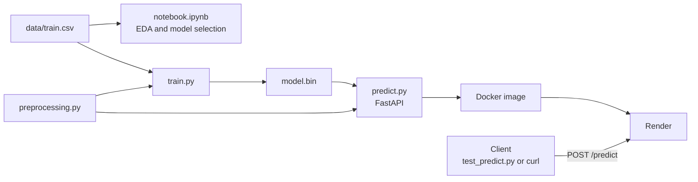
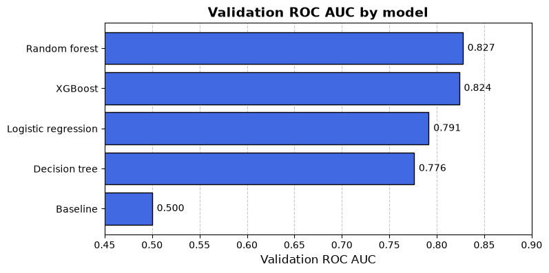
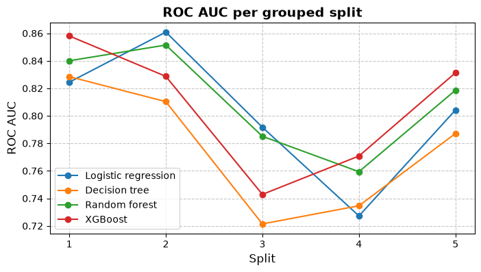
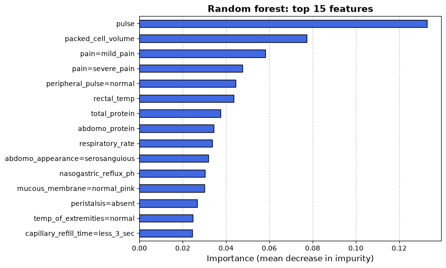
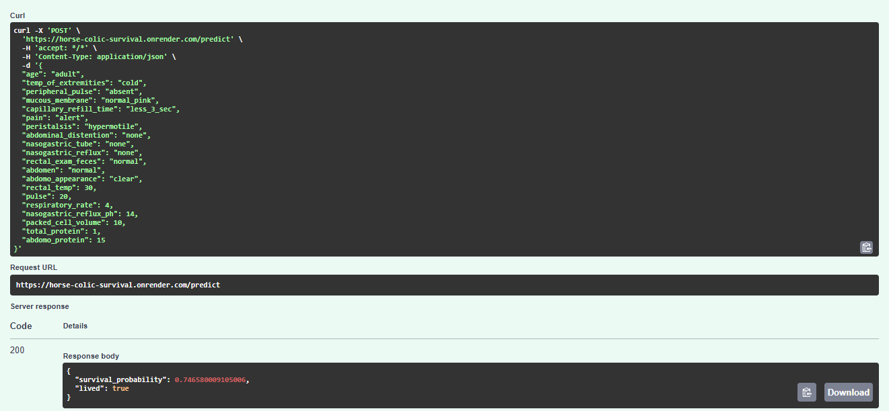
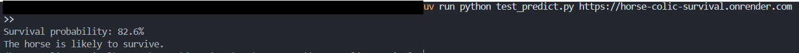

# Horse Colic Survival Prediction

**English** | [Español](README.es.md)

A machine learning web service that estimates the probability that a horse with colic will survive, using information available when it is admitted to a veterinary hospital.

Midterm project for [ML Zoomcamp](https://github.com/DataTalksClub/machine-learning-zoomcamp).

## Problem

Colic (abdominal pain) is a serious and potentially fatal condition in horses. On admission, veterinarians must quickly assess how severe a case is and discuss the options with the owner.

This project trains a model on clinical data such as vital signs, pain level and examination findings. It exposes the model through an API: a client sends a horse's data and receives a survival probability.

The score is meant to support the veterinarian's judgement, not to replace it.

## Dataset

The project uses the training data from the Kaggle competition [Predict Health Outcomes of Horses](https://www.kaggle.com/competitions/playground-series-s3e22) (Playground Series S3E22). This is a synthetic dataset derived from the real [Horse Colic dataset](https://archive.ics.uci.edu/dataset/47/horse+colic) from UCI, which has 368 cases.

- **Size:** 1,235 labelled rows and 29 columns.
- **Original target:** `outcome`, with the values `lived`, `died` and `euthanized`.
- **Project target:** `lived` versus `not lived` (`died` + `euthanized`).
- **Why binary:** the service estimates survival, and euthanasia is partly a human decision rather than a purely clinical outcome.
- **Missing values:** 464 rows have missing values, all in categorical columns. The CSV stores them as the text `None`, which pandas reads as missing by default. This is different from lowercase `none`, a valid category in columns such as `abdominal_distention`.
- **Repeated cases:** `hospital_number` has 255 unique values across the 1,235 rows, and 198 of them appear more than once. The data is synthetic, so a repeated value does not necessarily mean the same horse: 161 of those 198 values have more than one outcome.

The competition's `test.csv` has no `outcome` column (its labels are hidden), so it is not used: the validation and test sets are taken from `train.csv`.

### Excluded columns

| Columns | Reason |
|---|---|
| `id`, `hospital_number` | Identifiers (`hospital_number` is not a model feature, but it is used to group rows when splitting the data) |
| `cp_data` | UCI describes it as having no significance |
| `surgical_lesion`, `lesion_1`, `lesion_2`, `lesion_3` | Only known after surgery or autopsy, so they would leak future information |
| `surgery` | A treatment decision, usually not made at admission; removing it does not change the validation AUC (0.752 without it, 0.751 with it) |

The model uses the remaining 20 features: 7 numerical and 13 categorical.

## Approach

1. **Data preparation:** fill missing categorical values with an `"unknown"` category, merge five rare categories (artefacts of the synthetic data) into existing ones, and convert the `total_protein` values recorded in g/L to g/dL.
2. **Exploratory data analysis:** value ranges, missing values, target distribution, survival rate and risk ratio by category, mutual information, single-feature AUC and correlations.
3. **Validation strategy:** the data is split into train (60%), validation (20%) and test (20%) with `StratifiedGroupKFold`, so that each `hospital_number` value appears in only one set. A random split gives a more optimistic AUC (0.773 against 0.751 for the same model), because rows that share a value are often near-copies.
4. **Model training:** logistic regression, a decision tree, a random forest and XGBoost, with their hyperparameters tuned on the validation set.
5. **Model selection:** by ROC AUC, with accuracy and F1 as supporting metrics. Because a single validation set of 248 rows is noisy, the ranking is also checked on five grouped splits of the training and validation data. The chosen model is retrained on train and validation together and evaluated once on the test set.
6. **Deployment:** the final model is served with FastAPI, packaged with Docker and deployed to the cloud.

All the analysis is in [`notebook.ipynb`](notebook.ipynb).



## Results

### EDA highlights

- The classes are nearly balanced: 46.5% of the horses lived and 53.5% did not.
- `pain` is the most informative feature: 94% of alert horses survive, against 13–15% of those in severe or extreme pain.
- Among numerical features, a high `pulse` and a high `packed_cell_volume` (a sign of dehydration) are the strongest signs of a poor outcome (AUC 0.68 each on their own).
- Signs of poor circulation (cyanotic mucous membranes, cold extremities, absent peripheral pulse) and serosanguinous abdominal fluid go with lower survival.
- Missing values are informative: horses without a recorded nasogastric tube or abdomen examination survive less than average.

### Model comparison

| Model | Chosen hyperparameters | Validation AUC | Mean AUC on 5 grouped splits |
|---|---|---|---|
| **Random forest** | `n_estimators=200, max_depth=10, min_samples_leaf=5` | **0.827** | **0.811 ± 0.038** |
| XGBoost | `learning_rate=0.05, max_depth=3, min_child_weight=10, n_estimators=200` | 0.824 | 0.806 ± 0.048 |
| Logistic regression | `C=0.001` | 0.791 | 0.802 ± 0.049 |
| Decision tree | `max_depth=3, min_samples_leaf=20` | 0.776 | 0.776 ± 0.047 |
| Baseline (most frequent class) | – | 0.500 | – |



The random forest is chosen because it has the best ROC AUC in both estimates. XGBoost is practically tied with it: as the five grouped splits show, each of the two wins in some splits, and the differences between splits are larger than the differences between models.



### Final model on the test set

Retrained on train and validation (988 rows) and evaluated once on the test set (247 rows):

| ROC AUC | Accuracy | F1 |
|---|---|---|
| 0.761 | 0.725 | 0.657 |

The test score is at the lower end of the range seen across validation splits (0.759–0.851), partly because one `hospital_number` group makes up 19% of the test rows. At the 0.5 threshold the model is cautious: it recognises 86% of the horses that did not survive but only 57% of those that did, so the probability is more informative than the yes/no label.

The most important features of the final model agree with the EDA: `pulse` and `packed_cell_volume` lead, followed by the pain level and signs of circulation.



## Requirements

- [Git](https://git-scm.com/)
- [uv](https://docs.astral.sh/uv/), which manages Python and the project dependencies
- [Docker](https://www.docker.com/), to run the service in a container
- A [Kaggle](https://www.kaggle.com/) account, to download the data (an API token is only needed for the command-line download)

## How to run

### 1. Install the dependencies

```bash
git clone git@github.com:IgnaciocefisDataTalksClubCamps/horse-colic-survival.git
cd horse-colic-survival
uv sync --locked
```

`uv sync` creates the virtual environment in `.venv` with all the dependencies, including the development ones used by the notebook (Jupyter, Kaggle CLI, plotting libraries, XGBoost). You can prefix commands with `uv run` as shown below, so you don't need to activate it. To activate it manually:

```bash
source .venv/bin/activate      # Linux/macOS
.venv\Scripts\activate         # Windows
```

### 2. Download the data

The data is not included in this repository because the competition rules (section 7.B) do not allow redistributing it.

Accept the [competition rules](https://www.kaggle.com/competitions/playground-series-s3e22/rules), configure your Kaggle API token, and run:

```bash
uv run kaggle competitions download -c playground-series-s3e22 -p data --unzip
```

Alternatively, download the files from the competition's [Data page](https://www.kaggle.com/competitions/playground-series-s3e22/data) without an API token and extract them into `data/`. The training file must end up at `data/train.csv`, not in a subfolder.

### 3. Explore the notebook (optional)

```bash
uv run jupyter notebook notebook.ipynb
```

### 4. Train the model

```bash
uv run python train.py
```

It trains the random forest on train and validation, prints its test metrics and saves the model to `model.bin`:

```text
Training on 988 rows, testing on 247 rows
Test ROC AUC:  0.761
Test accuracy: 0.725
Test F1:       0.657
Model saved to model.bin
```

`model.bin` is already included in the repository, so this step is only needed to reproduce it.

### 5. Run the service locally

```bash
uv run uvicorn predict:app --host 0.0.0.0 --port 9696
```

### 6. Run the service with Docker

```bash
docker build -t horse-colic-survival .
docker run -it --rm -p 9696:9696 horse-colic-survival
```

The image installs only the runtime dependencies (`uv sync --locked --no-dev`) and copies `predict.py`, `preprocessing.py` and `model.bin`.

## Using the API

With the service running, you can use any of these options:

- Open the interactive documentation at <http://localhost:9696/docs>.
- Send a sample request with the test script. It takes the service URL as an optional argument:

  ```bash
  uv run python test_predict.py                          # http://localhost:9696
  uv run python test_predict.py https://<service-url>    # deployed service
  ```

- Send a request with `curl` (on Windows PowerShell, use `curl.exe`):

  ```bash
  curl -X POST http://localhost:9696/predict \
    -H "Content-Type: application/json" \
    -d '{"age": "adult", "temp_of_extremities": "normal", "peripheral_pulse": "normal",
         "mucous_membrane": "bright_pink", "capillary_refill_time": "less_3_sec", "pain": "alert",
         "peristalsis": "normal", "abdominal_distention": "none", "nasogastric_tube": "none",
         "nasogastric_reflux": "none", "rectal_exam_feces": "normal", "abdomen": "normal",
         "abdomo_appearance": "clear", "rectal_temp": 38.5, "pulse": 60, "respiratory_rate": 20,
         "nasogastric_reflux_ph": 7.0, "packed_cell_volume": 35.0, "total_protein": 7.0,
         "abdomo_protein": 2.0}'
  ```

  Response (the probability is about 0.83 for this horse):

  ```json
  {"survival_probability": 0.826, "lived": true}
  ```

| Endpoint | Method | Purpose |
|---|---|---|
| `/predict` | POST | Takes a horse's clinical data and returns the survival probability |
| `/health` | GET | Checks that the service is running |
| `/docs` | GET | Interactive documentation (the root URL `/` redirects here) |

### Input fields

The numerical fields are required. The categorical fields are optional: a missing value is treated as `"unknown"`, as in training. Unknown fields, invalid categories or out-of-range values are rejected with a `422` error.

| Field | Accepted values |
|---|---|
| `rectal_temp` | 30 – 45 (°C) |
| `pulse` | 20 – 250 (beats per minute) |
| `respiratory_rate` | 4 – 120 (breaths per minute) |
| `nasogastric_reflux_ph` | 0 – 14 |
| `packed_cell_volume` | 10 – 90 (%) |
| `total_protein` | 1 – 120 (g/dL, or g/L for values above 30, which are converted) |
| `abdomo_protein` | 0 – 15 (g/dL) |
| `age` | `adult`, `young` |
| `temp_of_extremities` | `cold`, `cool`, `normal`, `warm` |
| `peripheral_pulse` | `absent`, `reduced`, `normal`, `increased` |
| `mucous_membrane` | `normal_pink`, `bright_pink`, `pale_pink`, `pale_cyanotic`, `bright_red`, `dark_cyanotic` |
| `capillary_refill_time` | `less_3_sec`, `more_3_sec` |
| `pain` | `alert`, `depressed`, `mild_pain`, `severe_pain`, `extreme_pain` |
| `peristalsis` | `hypermotile`, `normal`, `hypomotile`, `absent` |
| `abdominal_distention` | `none`, `slight`, `moderate`, `severe` |
| `nasogastric_tube` | `none`, `slight`, `significant` |
| `nasogastric_reflux` | `none`, `less_1_liter`, `more_1_liter` |
| `rectal_exam_feces` | `normal`, `increased`, `decreased`, `absent` |
| `abdomen` | `normal`, `other`, `firm`, `distend_small`, `distend_large` |
| `abdomo_appearance` | `clear`, `cloudy`, `serosanguious` |

## Cloud deployment

The service is deployed on [Render](https://render.com) using its free plan, which builds the Docker image directly from this repository. The deployment is described in [`render.yaml`](render.yaml) (a Render Blueprint).

**Public URL:** <https://horse-colic-survival.onrender.com> (interactive documentation at <https://horse-colic-survival.onrender.com/docs>)

Test it from your machine:

```bash
uv run python test_predict.py https://horse-colic-survival.onrender.com
```

```text
Survival probability: 82.6%
The horse is likely to survive.
```

**Screenshots of the deployed service:**

Request to `/predict` from the interactive documentation:



`test_predict.py` run against the deployed service:



To deploy it yourself:

1. Push the repository to GitHub, including `model.bin`.
2. Create a free account at [render.com](https://render.com) and connect your GitHub account.
3. Select **New → Blueprint**, choose the repository and confirm. Render reads `render.yaml`, builds the image from the `Dockerfile` and starts the service on the free plan.

   Alternatively, select **New → Web Service**, choose the repository, pick **Docker** as the language and the **Free** instance type, set the health check path to `/health` and add the environment variable `PORT=9696`.

4. Test the deployed service:

   ```bash
   uv run python test_predict.py https://<your-service>.onrender.com
   ```

The free plan stops the service after 15 minutes without traffic, so the first request after a pause can take about a minute.

To remove the deployment, delete the service from the Render dashboard (**Settings → Delete Web Service**).

## Project structure

```text
├── README.md          # Documentation in English
├── README.es.md       # Documentation in Spanish
├── notebook.ipynb     # Data preparation, EDA and model selection
├── preprocessing.py   # Data cleaning shared by train.py and predict.py
├── train.py           # Trains and saves the final model
├── predict.py         # FastAPI web service
├── test_predict.py    # Sample request to the service
├── model.bin          # Trained model (random forest pipeline)
├── pyproject.toml     # Dependencies
├── uv.lock            # Locked dependency versions
├── .python-version    # Python version
├── Dockerfile         # Container image for the service
├── .dockerignore      # Files excluded from the Docker build
├── render.yaml        # Cloud deployment on Render
├── images/            # Charts and screenshots used in this README
└── data/              # Dataset (downloaded from Kaggle, not included)
```

## Limitations

- The data is synthetic, derived from a 368-case dataset, so the model is not clinically validated and must not be used for real veterinary decisions.
- The dataset is small and its rows are grouped, so performance estimates vary by about ±0.05 AUC depending on the split.
- At the 0.5 threshold the model misses many horses that survive, so the probability is more informative than the yes/no label.
- The service requires all numerical features, but some tests, such as `abdomo_protein` or `nasogastric_reflux_ph`, are not always available at admission.
- The `total_protein` unit correction assumes that values above 30 are in g/L.
- The target groups `died` and `euthanized` together, so it does not separate clinical death from the decision to euthanize.
